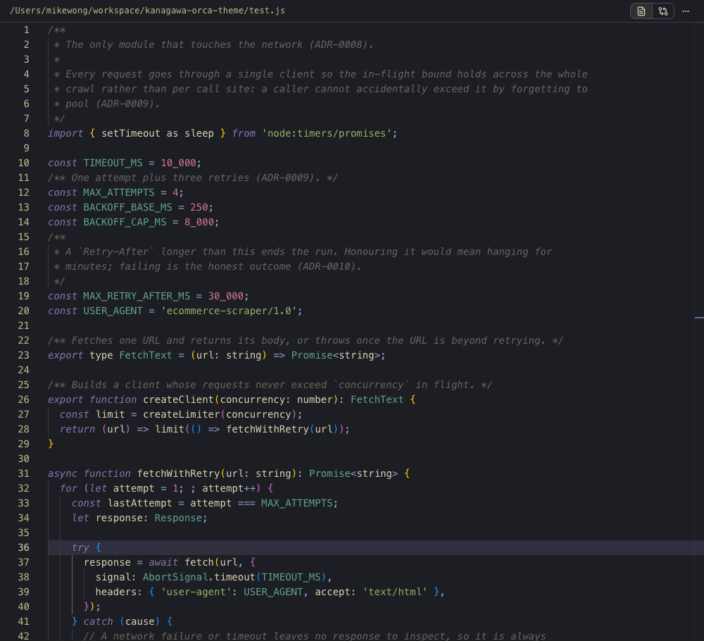
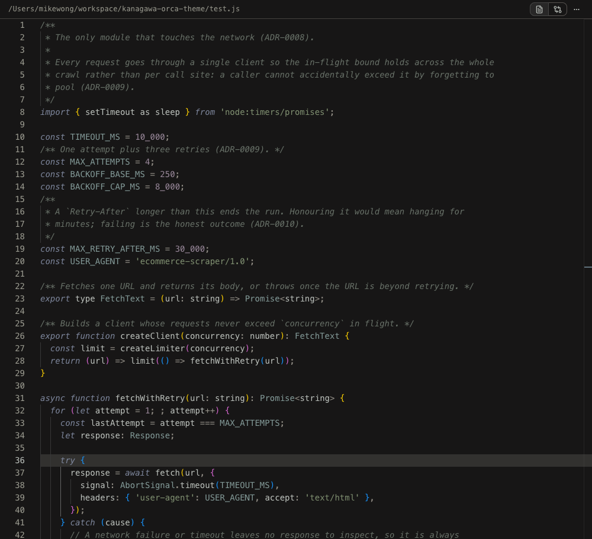
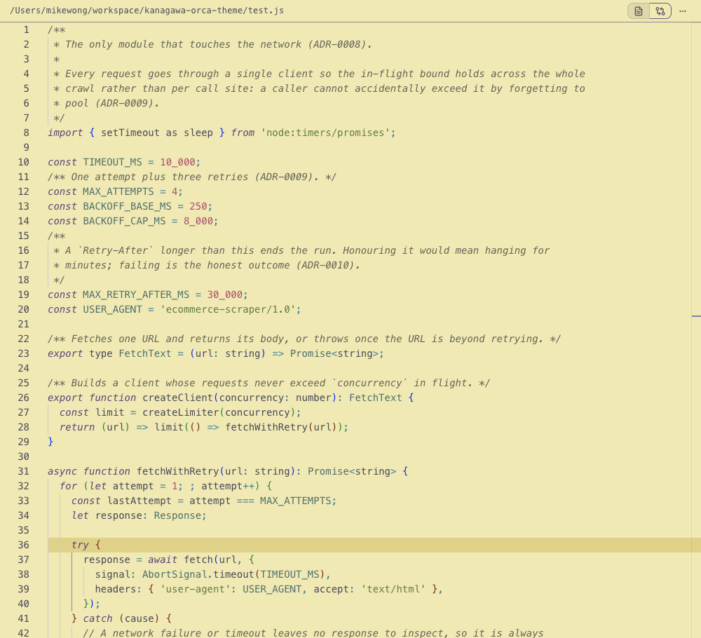

# Kanagawa for Orca

Wave, Dragon and Lotus themes for Orca's app, code editor and terminal. Inspired by
Katsushika Hokusai's *The Great Wave off Kanagawa*, using the palettes from
[kanagawa.nvim](https://github.com/rebelot/kanagawa.nvim) and the
[Kanagawa VS Code theme](https://marketplace.visualstudio.com/items?itemName=metaphore.kanagawa-vscode-color-theme).

| Variant | Mode | Background | Foreground | Character |
| --- | --- | --- | --- | --- |
| Kanagawa Wave | Dark | `#1F1F28` | `#DCD7BA` | Ink blue, warm text, violet and blue accents |
| Kanagawa Dragon | Dark | `#181616` | `#C5C9C5` | Charcoal, muted greens and earthy accents |
| Kanagawa Lotus | Light | `#F2ECBC` | `#545464` | Warm paper, dark ink and restrained colors |

### Wave



### Dragon



### Lotus



Requires **Orca 1.4.246 or later**. This is a data-only plugin: no executable
entry point, requested capabilities, dependencies or build step.

## Install locally

1. Keep this folder somewhere permanent.
2. In **Settings → Plugins**, turn on plugins if necessary.
3. Open **Development folders…**, add this folder and enable the plugin.
   Its local key is `local.kanagawa-theme`.
4. In **Settings → Appearance**, select **Kanagawa Wave** or **Kanagawa Dragon**
   as the Dark theme and **Kanagawa Lotus** as the Light theme. Orca uses the
   matching slot for its current appearance mode; System mode follows the OS.
5. The editor follows the app theme by default. To choose it independently, use
   the **Light/Dark editor theme** selectors in Appearance.
6. Select the matching **Kanagawa Wave**, **Kanagawa Dragon** or **Kanagawa Lotus**
   palette in Orca's terminal theme settings. Terminal palettes are separate
   contributions; changing the app theme does not select a terminal palette.

Alternatively, from this folder with Orca running:

```sh
orca plugin validate .
orca plugin dev load .
```

Orca watches development folders and reloads changes. To stop loading the plugin:

```sh
orca plugin dev unload .
```

For a temporary development session, `orca plugin dev watch .` loads and watches
the folder until Ctrl-C. This project is not published to a catalog or repository;
there is no remote install URL yet.

## What's themed

Each app theme includes panels, menus, controls, sidebars, tabs, chat surfaces,
links, Git decorations and diff hues. Editor backgrounds, text, cursor/focus,
line-number colors and syntax rules use the same palette. Each terminal palette
includes all 16 ANSI colors, background, foreground, cursor and selection.

The port follows the official Midnight plugin's manifest and app/tokenColors
structure. Orca derives omitted tokens, including editor selection and diff tints.
Syntax colors come from kanagawa.nvim's highlight groups, mapped to TextMate
scopes and to the Monaco tokens Orca's built-in languages emit. Monaco's built-in
tokenizers do not tell parameters, constants or properties apart, so in JS/TS
UPPER_CASE constants use the type color and parameters use the default text color.

Lotus has a handful of palette substitutions to meet Orca's contrast gates. See
[ATTRIBUTION.md](ATTRIBUTION.md) for source revisions and mapping details.
Terminal ANSI colors are preserved exactly, including intentionally low-contrast
black/bright-black colors; applications choose how those slots are used.

Orca retains its own trust/approval dialog colors. Sidebar **Match terminal** or
**Tinted** settings, and chat's match-terminal setting, can override parts of an
app theme.

## Validate

No package installation or build is required. With Python 3 and the Orca CLI:

```sh
orca plugin validate .
PYTHONDONTWRITEBYTECODE=1 python3 -m unittest discover -s tests -v
```

Orca validates the manifest, supported tokens, syntax settings, terminal slots
and referenced files. The offline tests check all variants, complete ANSI
palettes, file-size limits, supported scope forms, 4.5:1 app text contrast and
3:1 syntax/Git-decoration contrast so colors are not silently dropped at runtime.

For visual review, load the development folder and inspect each variant in the
app, an editor with comments/strings/numbers/functions, a diff and a terminal
with normal and bright ANSI text. Validation does not replace that visual check.

## License and credits

MIT; see [LICENSE](LICENSE). Original Kanagawa by **Tommaso Laurenzi (rebelot)**,
VS Code port by **Pierre-Alain Castella (metaphore / paccodes)**, and Orca Midnight
by **Lovecast Inc. / stablyai**. This is an independent port, not an official
release from those projects. Full upstream MIT notices are retained in
[licenses/](licenses/); provenance and authoring references are in
[ATTRIBUTION.md](ATTRIBUTION.md).
